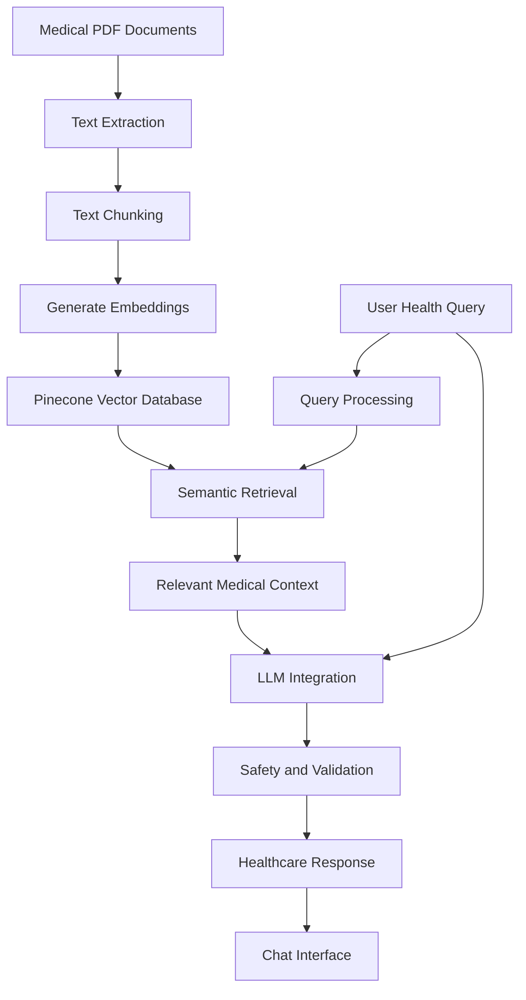

# 🏥 HealthBridge: Intelligent Healthcare Chatbot

An AI-powered healthcare assistant that combines Large Language Models (LLMs) with a medical knowledge base to provide context-aware health information, preliminary symptom assessment, and general healthcare guidance.

## 📌 Project Overview

HealthBridge is a mini project developed to make healthcare information more accessible through conversational AI. It integrates an LLM with a medical knowledge base containing healthcare information extracted from medical PDF documents.

The system uses Retrieval-Augmented Generation (RAG) to retrieve relevant medical information and provide responses grounded in the retrieved context. It also incorporates safety checks and medical disclaimers to reduce the risk of misleading responses.

## 🎯 Objectives

- Develop an intelligent chatbot for healthcare-related queries.
- Integrate LLMs with a domain-specific medical knowledge base.
- Retrieve relevant information from medical PDF documents.
- Provide preliminary symptom assessment and general health guidance.
- Reduce unsupported responses through knowledge grounding and validation.
- Deliver an intuitive conversational interface for users.

## ✨ Key Features

- **AI-Powered Conversations:** Understands natural-language healthcare questions.
- **Medical Knowledge Retrieval:** Retrieves relevant information from medical PDF documents.
- **RAG Pipeline:** Combines retrieved medical context with LLM-generated responses.
- **Symptom Assistance:** Provides preliminary information about symptoms and possible conditions.
- **Medication Information:** Offers general medication-related guidance based on available knowledge.
- **Safety Mechanisms:** Includes medical disclaimers and guidance to consult healthcare professionals.
- **User Authentication:** Includes login and account-related interface features.
- **Chat History:** Supports managing previous conversations.
- **User-Friendly Interface:** Provides a dedicated healthcare chatbot interface.

## 🏗️ System Architecture

The system follows an LLM + Medical Knowledge Base architecture.



## ⚙️ How It Works

1. **Document Ingestion:** Medical information is extracted from PDF documents.
2. **Text Chunking:** Extracted content is divided into smaller text segments.
3. **Embedding Generation:** Text segments are converted into vector representations.
4. **Knowledge Storage:** Embeddings are stored in the Pinecone vector database.
5. **User Query:** The user submits a healthcare-related question.
6. **Semantic Search:** Relevant medical information is retrieved from the knowledge base.
7. **LLM Response Generation:** The language model generates a response using the retrieved context.
8. **Safety Validation:** The response is checked against the system's safety rules.
9. **Response Delivery:** The final response is displayed in the chatbot interface.

## 🛠️ Technology Stack

The project report describes the following technologies and architectural components. Confirm the exact libraries and frameworks against the implementation before finalizing this list.

| Component | Technology |
|---|---|
| AI / Language Model | Large Language Model (LLM) |
| Knowledge Retrieval | Retrieval-Augmented Generation (RAG) |
| Vector Database | Pinecone |
| Knowledge Source | Medical PDF documents |
| Embeddings | Text embedding models |
| Backend | Python / Flask, if used in the implementation |
| Frontend | HTML, CSS, JavaScript or React, depending on implementation |
| Data Processing | PDF text extraction and text chunking |

## 🖥️ Application Interface

The application includes the following interfaces:

- Login page
- HealthBridge chatbot home page
- New conversation interface
- Healthcare query and response interface
- Conversation history management

> Add your actual application screenshots to a `screenshots/` directory and embed them below.

```markdown


```

## 🚀 Getting Started

### Prerequisites

- Python, if the backend uses Python
- Git
- Access to the configured LLM API
- Pinecone account and API key, if Pinecone is used
- The required dependencies listed in the project files

### 1. Clone the Repository

```bash
git clone <YOUR_GITHUB_REPOSITORY_URL>
cd <YOUR_PROJECT_FOLDER>
```

### 2. Create a Virtual Environment

For Windows:

```bash
python -m venv venv
venv\Scripts\activate
```

### 3. Install Dependencies

If the repository contains a `requirements.txt` file:

```bash
python -m pip install --upgrade pip
pip install -r requirements.txt
```

### 4. Configure Environment Variables

Create a `.env` file if your application uses environment variables.

Example:

```env
LLM_API_KEY=your_llm_api_key
PINECONE_API_KEY=your_pinecone_api_key
```

Use the actual variable names expected by your application. Do not commit API keys, passwords, or other secrets to GitHub.

### 5. Run the Application

Use the command required by your actual application entry point.

For example, if the project uses Flask and the entry point is `app.py`:

```bash
python app.py
```

If the application uses a different entry point or framework, replace this command with the correct one.

## 🔒 Safety and Limitations

- This chatbot provides general healthcare information and preliminary symptom guidance.
- It does not replace a qualified doctor or professional medical diagnosis.
- Responses depend on the quality, completeness, and currency of the medical knowledge base.
- LLM-generated responses may still contain errors despite retrieval and validation.
- Users should consult qualified healthcare professionals for medical decisions.
- API credentials and sensitive health information must be handled securely.

## 🔮 Future Enhancements

- Voice-based healthcare assistance.
- Multilingual support for Indian languages.
- Integration with hospital management systems.
- Appointment scheduling and telemedicine connectivity.
- Medical image and report analysis.
- Expanded medical knowledge bases and updated clinical guidelines.
- Improved privacy, security, and clinical evaluation.

## 👨‍💻 Project Team

**Department of Computer Science and Engineering (Data Science)**  
Jawaharlal Nehru New College of Engineering (JNNCE)  
Shivamogga, Karnataka

| Name | USN |
|---|---|
| Ranganath TY | 4JN23CD043 |

**Project Guide:** Dr. Manjula G R  
Professor and Head, Department of CS&E (Data Science)

## 🎓 Project Information

- **Project Type:** Mini Project
- **Academic Year:** 2025–2026
- **Institution:** JNNCE, Shivamogga
- **University:** Visvesvaraya Technological University (VTU)

## 📄 Disclaimer

HealthBridge is an academic project intended for educational and informational purposes. It is not a certified medical diagnostic system and must not be used as a substitute for professional medical care.

## 📜 License

Choose an appropriate open-source license before publishing this project for reuse. If you have not selected one, the repository has no explicitly granted open-source license by default.
